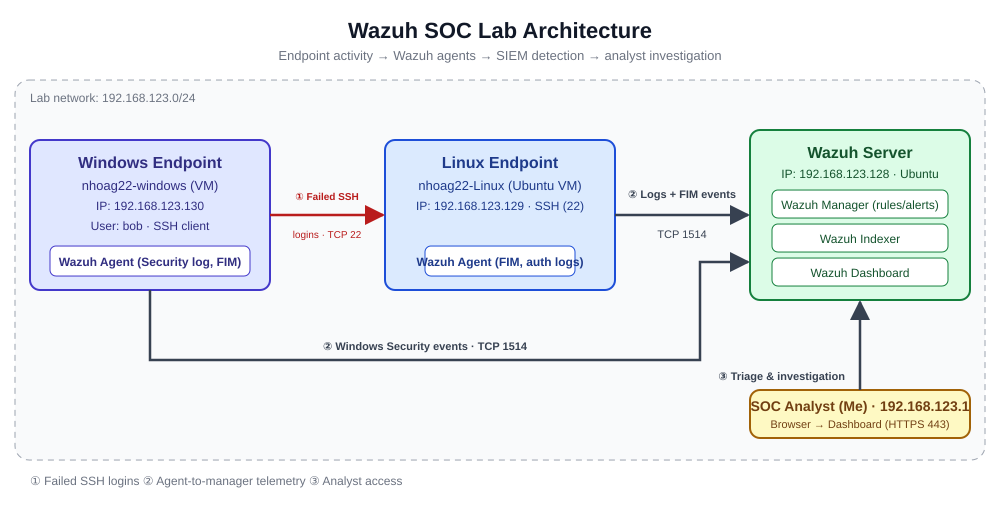
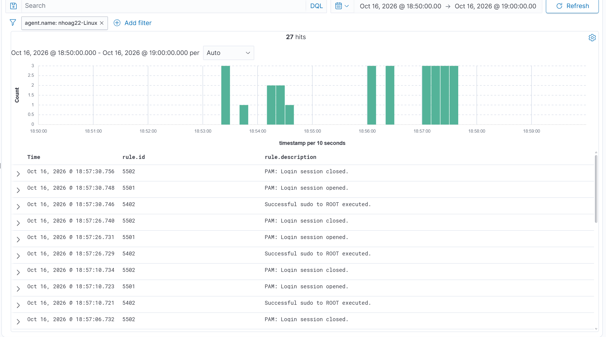
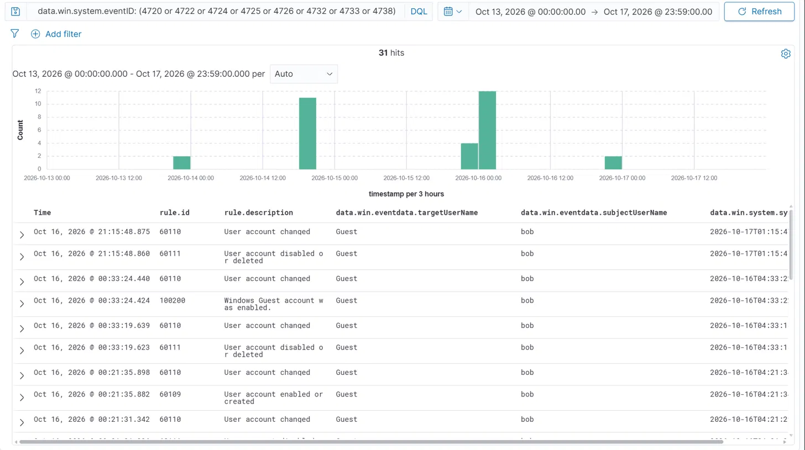
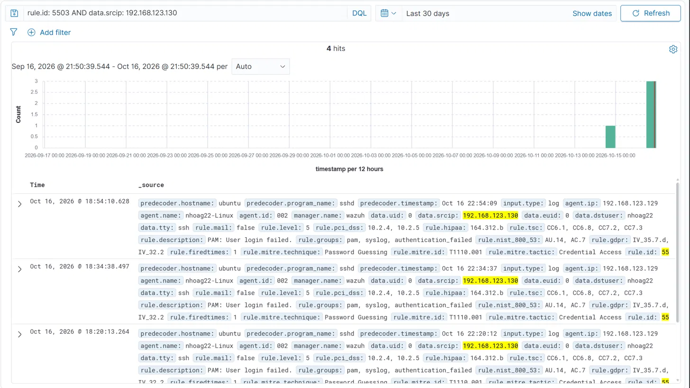
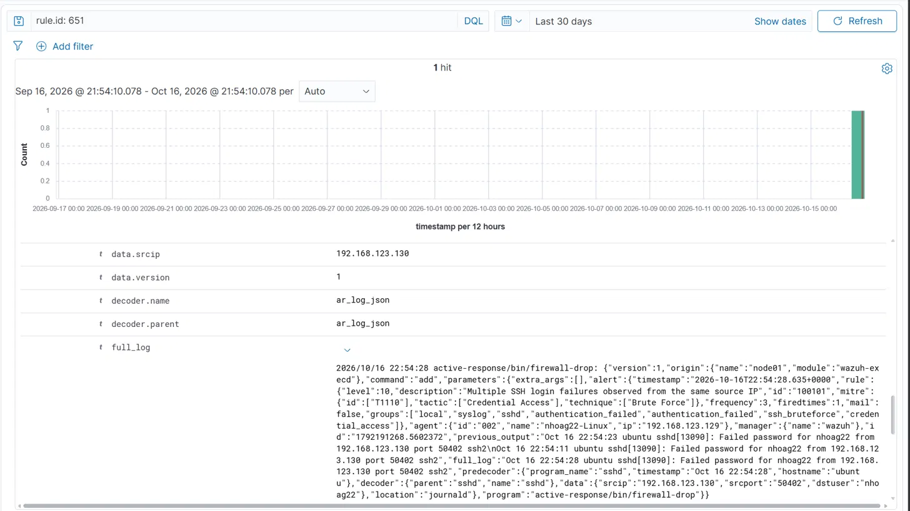
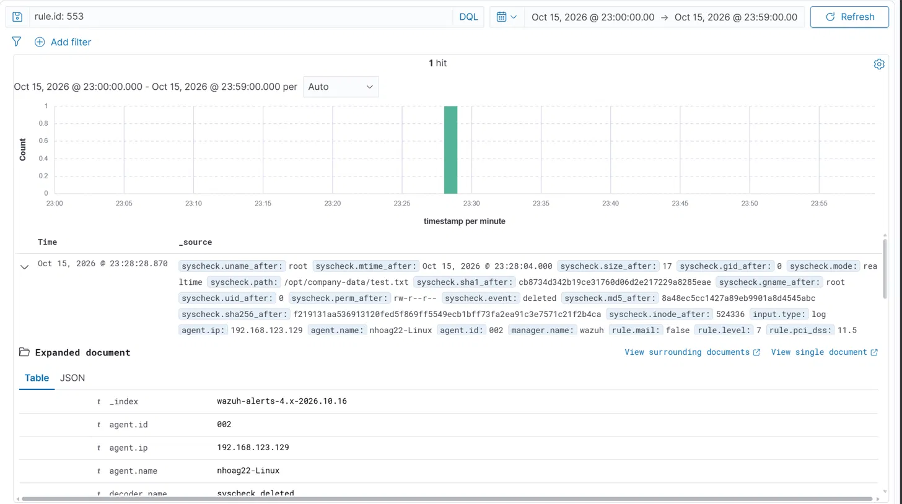
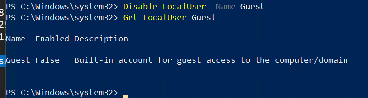

# Wazuh SOC Analyst Challenge: Incident Investigation Report

> Hands-on SOC investigation completed with Wazuh.

**Analyst:** Nathan Hoag
**Tools:** Wazuh (SIEM/XDR) with Manager, Indexer and Dashboard; Wazuh agents on a Linux and a Windows endpoint
**Date completed:** October 16, 2026
**Case status:** Closed / Recommendations issued

---

## Overview

I built a small home SOC lab around Wazuh, with agents on a Linux and a Windows endpoint, and investigated three clusters of activity that Wazuh detected between October 13 and 16, 2026:

1. **Windows account manipulation:** a new account (`student1`) created and added to Administrators, then deleted, and the built-in `Guest` account repeatedly enabled and disabled while I developed and tested a custom detection rule.
2. **File deletions** on both endpoints, caught by File Integrity Monitoring.
3. **SSH password guessing** from the Windows host against the Linux endpoint, flagged by a custom brute-force rule I wrote and blocked automatically by Wazuh's firewall-drop active response.

I triaged the alerts in the Wazuh dashboard, built a timeline from the logs, identified the affected hosts and accounts, and documented my findings and recommendations below.

**Goals:**
- Practice the SOC workflow: detect, triage, investigate, report
- Analyze Windows security events, Linux authentication logs, File Integrity Monitoring (FIM) and active response alerts
- Write and test custom Wazuh detection rules (100101 for SSH brute force, 100200 for the `Guest` account being enabled)
- Answer the core investigation questions (who, what, when, where, why, how)
- Write clear, actionable recommendations for containment and prevention

---

## Lab Architecture



| Component | Role | OS / Details | IP |
|---|---|---|---|
| Windows endpoint | Wazuh agent `nhoag22-windows` (ID 001) forwarding the Security log and FIM events. Account changes were made here as `bob`, and it was the source of the failed SSH logins | Windows 10 VM, hostname `DESKTOP-5G9PQQB` | 192.168.123.130 |
| Linux endpoint | Wazuh agent `nhoag22-Linux` (ID 002): auth logs and FIM. Target of the SSH attempts | Ubuntu Linux VM | 192.168.123.129 |
| Wazuh server | Manager (`wazuh`), indexer and dashboard; receives events and raises alerts | Ubuntu Linux VM | 192.168.123.128 |
| Analyst workstation | Host machine; dashboard access and SSH to the Linux endpoint | Host OS | 192.168.123.1 |

**Data flow:** The Windows VM attempts SSH logins to the Linux endpoint (TCP 22). Both Wazuh agents forward their logs and FIM events to the Wazuh manager (TCP 1514). Rules generate alerts, and the firewall-drop active response blocks offending hosts. I triage and investigate in the dashboard over HTTPS (443).

---

## 1. Findings

| Investigation Question | Answer |
|---|---|
| What happened? | Three clusters of activity. **(1)** On the Windows host `nhoag22-windows` (192.168.123.130), account `bob` created `student1`, added it to Administrators 17 seconds later, then removed and deleted it within about a minute, and repeatedly enabled and disabled the built-in `Guest` account. **(2)** FIM logged file deletions on both hosts: `c:\companydata\payroll.txt` on the Windows host and `/opt/company-data/test.txt` on the Linux host. **(3)** On Oct 16, the same Windows host (192.168.123.130) made failed SSH password attempts against `nhoag22` on the Linux host; custom rule 100101 flagged them and firewall-drop blocked the source two seconds later. |
| When did it happen? | Oct 13 22:14 EDT through Oct 16 18:57 EDT, 2026 (all times Eastern). `student1` created Oct 14 at 19:53:09 and added to Administrators at 19:53:26. File deletions Oct 15 at 17:34 and 23:28. `Guest` toggled Oct 14 to Oct 16 00:33. Failed SSH attempts from Oct 16 at 18:20, with the brute-force detection and block at 18:54. After the block, the only Linux alerts through 19:00 were my own SSH login and `sudo` commands. |
| Which hosts were involved? | `nhoag22-windows` (hostname `DESKTOP-5G9PQQB`, 192.168.123.130), the source of the account changes and the failed SSH logins. `nhoag22-Linux` (192.168.123.129, Ubuntu), the target. Analyst host `192.168.123.1`. Wazuh manager `wazuh`. |
| Which accounts were changed? | **Windows (`nhoag22-windows`), all changes made by `bob`:** `student1` (SID ending -1003) created, added to `Users` and `Administrators`, then removed and deleted (4720/4732/4733/4726); `Guest` enabled and disabled repeatedly (4722/4725/4738); `defaultuser0` deleted (4726). **Linux:** no accounts changed; `nhoag22` was the target of SSH guessing. `Guest` stayed enabled until I disabled it during remediation. |
| Was a file deleted? | **Yes, two files.** `/opt/company-data/test.txt` on `nhoag22-Linux` was deleted on **Oct 15, 2026 at 23:28:28 EDT** (03:28:28 UTC Oct 16), detected by FIM in real time (rule 553, level 7). The alert itself does not record which user removed it. A second FIM alert (rule 553) shows `c:\companydata\payroll.txt` deleted on the Windows host `nhoag22-windows` earlier that day, at 17:34:14 EDT. I deleted both files myself on purpose to test FIM. |
| Was SSH abuse observed? | **Yes.** Failed logins for `nhoag22` from `192.168.123.130` triggered rule 5503 at 18:20, 18:34 and 18:54 EDT on Oct 16. In the 18:54 session, `sshd` logged three failed passwords (rule 5760 twice, then custom rule 100101, level 10, frequency 3), and firewall-drop (rule 651) blocked the source about two seconds later. Wazuh also logged successful SSH logins (rule 5715) at 18:53:28 EDT from `192.168.123.130` itself, about 40 seconds before the failed attempts (my own accidental login, made just before I deliberately typed wrong passwords), and at 18:56:07 EDT from my analyst host, `192.168.123.1`. Earlier failed attempts for a user named `fakeuser` also appear on Oct 14. |
| What should we recommend? | See [Recommendations](#5-recommendations) |

### Key Indicators of Compromise (IOCs)

| Type | Value | Notes |
|---|---|---|
| Source host | 192.168.123.130 (`nhoag22-windows`) | Source of the failed SSH logins; blocked by firewall-drop on the Linux host |
| Acting account (Windows) | bob | Performed every account change on `nhoag22-windows` |
| Created, escalated, deleted account | student1 (SID ending -1003) | Created disabled with "Password Not Required", added to Administrators, deleted about a minute after creation |
| Repeatedly toggled account | Guest | 9 enable/disable events between Oct 14 and Oct 16; disabled during remediation |
| Targeted account (Linux) | nhoag22 | Account being guessed over SSH |
| Target host | nhoag22-Linux (192.168.123.129) | Wazuh agent ID 002 |
| Deleted file (Linux) | `/opt/company-data/test.txt` | 17 bytes, owner root, `rw-r--r--`; detected by FIM |
| Deleted file (Windows) | `c:\companydata\payroll.txt` | Detected by FIM on `nhoag22-windows` at Oct 15 17:34:14 EDT (rule 553) |
| Ruled out: legitimate login | 192.168.123.1 → `nhoag22` at 18:56:07 EDT | My own SSH session from the analyst host (rule 5715), followed by `sudo` commands (rule 5402) |
| Wazuh rules (Linux) | 5503, 5760, 100101 (custom, written by me), 651, 553, 5715, 5402 | PAM failure, sshd failure, brute force, active response, file deleted, SSH success, sudo |
| Wazuh rules (Windows) | 60109, 60110, 60111, 60154 (level 12), 60170, 100200 (custom, written by me) | Account created/enabled, changed, disabled/deleted, Administrators and Users group changes, Guest enabled |
| Windows event IDs | 4720, 4722, 4725, 4726, 4732, 4733, 4738 | Account created, enabled, disabled, deleted, group member added/removed, changed |

---

## 2. Investigation Summary

Wazuh surfaced three clusters of activity, and the Windows host `nhoag22-windows` (192.168.123.130) is behind two of them. On Oct 14, the account `bob` created a local account, `student1`, which was created disabled with "Password Not Required" set. It was added to the Administrators group 17 seconds later (rule 60154, the highest-severity alert in this case at level 12), then removed from its groups and deleted about a minute after it was created. Between Oct 14 and Oct 16, `bob` also enabled and disabled the built-in `Guest` account nine times, leaving it enabled. I used these cycles to develop and test a custom rule I wrote (100200, "Windows Guest account was enabled"): the earlier enable events matched only the built-in rule 60109, and the final enable at 00:33 matched 100200. Creating an admin account and deleting it, and toggling `Guest`, are typical persistence and cleanup behaviors. File Integrity Monitoring also recorded two file deletions on Oct 15: `c:\companydata\payroll.txt` on the Windows host at 17:34 and `/opt/company-data/test.txt` on the Linux host at 23:28.

Starting at 18:20 EDT on Oct 16, Wazuh recorded failed SSH logins for `nhoag22` on `nhoag22-Linux`, all from 192.168.123.130, the same Windows host. The attempts at 18:20 and 18:34 were isolated, but the 18:54 attempt went further. After a third failed password within about 17 seconds, a custom rule I wrote (100101, level 10) flagged an SSH brute-force attempt, and about two seconds later the firewall-drop active response blocked the source. Wazuh also logged a successful SSH login from the same Windows host at 18:53:28 EDT, 41 seconds before the first failure of the 18:54 attempt, so that host had valid credentials; the session closed 12 seconds later. This was my own accidental login, made just before I deliberately entered wrong passwords, but in a real incident it would show that the attacker already knew the password. A second successful login at 18:56:07 EDT came from `192.168.123.1`, my own session from the analyst host. In that session I ran five `sudo` commands to verify the block (rule 5402), so I ruled it out as benign.

The Oct 14 events reached Wazuh about 11 minutes after Windows logged them, so for those I used the event's own `systemTime` instead of the dashboard's Time column. For every other Windows event the two matched to within seconds.

### Timeline of Events

All times are Eastern (EDT, UTC-4). Rows marked **(event time)** use the Windows `systemTime` field because Wazuh received those events late. Raw host logs are in UTC.

| Time (EDT) | Host | Event | Event ID / Wazuh Rule |
|---|---|---|---|
| Oct 13, 22:14:46 | nhoag22-windows | `bob` removes a member from `Users` and deletes account `defaultuser0` | 4733, 4726 / 60170, 60111 |
| Oct 14, ~19:52 (event time) | nhoag22-windows | `bob` enables and modifies `Guest` (its password was last set at 19:52:45) | 4722, 4738 / 60109, 60110 |
| Oct 14, 19:53:09 (event time) | nhoag22-windows | `bob` creates `student1` (SID ending -1003), disabled, "Password Not Required" set | 4720 / 60109 |
| Oct 14, ~19:53:1x (event time) | nhoag22-windows | `student1` enabled, modified and added to `Users` | 4722, 4738, 4732 / 60109, 60110, 60170 |
| Oct 14, 19:53:26 (event time) | nhoag22-windows | `student1` added to `Administrators`, 17 seconds after creation | 4732 / 60154 (level 12) |
| Oct 14, ~19:54:0x (event time) | nhoag22-windows | `student1` removed from `Administrators` and `Users`, then deleted | 4733, 4726 / 60154, 60170, 60111 |
| Oct 15, 17:34:14 | nhoag22-windows | `c:\companydata\payroll.txt` deleted (FIM) | 553 |
| Oct 15, 23:28:28 | nhoag22-Linux | `/opt/company-data/test.txt` deleted (FIM, realtime). Separate from the other activity. | 553 |
| Oct 15, 23:33:32 | nhoag22-windows | `Guest` disabled | 4725, 4738 / 60111, 60110 |
| Oct 15, 23:50:29 | nhoag22-windows | `Guest` enabled | 4722, 4738 / 60109, 60110 |
| Oct 16, 00:04:21 / 00:04:27 | nhoag22-windows | `Guest` disabled, then re-enabled 6 seconds later | 4725, 4722, 4738 |
| Oct 16, 00:21:31 / 00:21:35 | nhoag22-windows | `Guest` disabled, then re-enabled 4 seconds later | 4725, 4722, 4738 |
| Oct 16, 00:33:19 / 00:33:24 | nhoag22-windows | `Guest` disabled, then re-enabled 5 seconds later; my custom rule 100200 fires for the first time | 4725, 4722, 4738 / 100200 |
| Oct 16, 18:20:13 | nhoag22-Linux | PAM authentication failure for `nhoag22` from 192.168.123.130 (earlier attempt) | 5503 |
| Oct 16, 18:34:38 | nhoag22-Linux | PAM authentication failure for `nhoag22` from 192.168.123.130 (earlier attempt) | 5503 |
| Oct 16, 18:53:28 | nhoag22-Linux | Successful SSH login from 192.168.123.130 (valid credentials; my accidental login); session closed at 18:53:40 | 5715, 5501, 5502 |
| Oct 16, 18:54:09 | nhoag22-Linux | `sshd[13090]` PAM authentication failure for `nhoag22` from 192.168.123.130 | 5503 |
| Oct 16, 18:54:11 | nhoag22-Linux | Failed password for `nhoag22` from 192.168.123.130 (port 50402) | 5760 |
| Oct 16, 18:54:23 | nhoag22-Linux | Second failed password, same SSH session | 5760 |
| Oct 16, 18:54:28 | nhoag22-Linux | Third failure triggers brute-force alert | 100101 (level 10) |
| Oct 16, 18:54:30 | nhoag22-Linux | Host blocked by firewall-drop active response | 651 |
| Oct 16, 18:56:07 | nhoag22-Linux | Successful SSH login for `nhoag22` from 192.168.123.1 (my analyst host; legitimate) | 5715 |
| Oct 16, 18:56:26 to 18:57:30 | nhoag22-Linux | Five `sudo`-to-root commands and PAM sessions from my analyst session, run to verify the block | 5402, 5501, 5502 |
| Oct 16, 21:15:47 | nhoag22-windows | Remediation: I disabled `Guest` (`Disable-LocalUser`); `Get-LocalUser Guest` shows `Enabled: False` | 4725, 4738 |

---

## 3. Who, What, When, Where, Why, How

| | |
|---|---|
| **Who** | Account `bob` on `nhoag22-windows` (192.168.123.130) made every Windows account change. The same host made a successful SSH login at 18:53:28 and then the failed SSH logins. Analyst host `192.168.123.1` made the SSH login at 18:56 and the `sudo` commands that followed. |
| **What** | Windows account manipulation (`student1` created, escalated and deleted; `Guest` toggled), a FIM-detected file deletion on Linux, and SSH password guessing that Wazuh detected (rules 5503, 5760 and 100101) and contained (rule 651). |
| **When** | Oct 13 22:14 to Oct 16 18:57 EDT, 2026. The SSH activity stopped at the 18:54 block. The last Windows account change before remediation was Oct 16 00:33 EDT. |
| **Where** | `nhoag22-windows` (Windows Security event log) and `nhoag22-Linux` (SSH on port 22, `/opt/company-data`). |
| **Why** | The activity was simulated in my lab for training. I performed the account changes as `bob` on the Windows VM, toggled `Guest` to develop and test custom rule 100200, ran the failed SSH attempts from that same VM (after an accidental successful login just before them), and deleted `/opt/company-data/test.txt` and `c:\companydata\payroll.txt` myself to test File Integrity Monitoring. In a real incident, creating an admin account and deleting it, repeatedly enabling `Guest`, and guessing SSH passwords from the same host would indicate persistence, privilege escalation, evasion and a lateral-movement attempt. |
| **How** | Windows: local account management run as `bob` (`student1` created, added to Administrators, then deleted; `Guest` enabled and disabled). Linux: repeated SSH password attempts from the Windows host generated PAM and sshd failures, which the Wazuh agent forwarded to the manager. |

---

## 4. Evidence & Methodology

1. **Detection (Linux, Oct 16 18:50 to 19:00):** Filtering to `agent.name: nhoag22-Linux` gives 27 hits that show the failed logins, the brute-force alert (100101), the firewall-drop block (651), and my own SSH login and `sudo` commands afterward.
   
2. **Windows account activity (`nhoag22-windows`, every event by `bob`):** Discover query `data.win.system.eventID: (4720 or 4722 or 4724 or 4725 or 4726 or 4732 or 4733 or 4738)` returns 31 hits (29 from the lab plus 2 from my `Guest` remediation). Columns show `targetUserName` (account changed), `subjectUserName` (who changed it) and `systemTime`.
   
3. **SSH abuse analysis:** Filtered on `rule.id: 5503 AND data.srcip: 192.168.123.130`, which returns 4 hits (three on Oct 16 at 18:20, 18:34 and 18:54), confirming a single source.
   
4. **Containment:** The firewall-drop active response alert (rule 651) shows Wazuh blocking `192.168.123.130` automatically.
   
5. **File deletion (FIM):** The Wazuh agent's syscheck module logged `File '/opt/company-data/test.txt' deleted` in realtime mode at 03:28:28 UTC on Oct 16 (rule 553, level 7). The last known state shows a 17-byte file owned by root, last modified 24 seconds before deletion. The owner shown is the file's, not necessarily the user who deleted it. A second rule 553 alert on `nhoag22-windows` shows `c:\companydata\payroll.txt` deleted at 17:34:14 EDT the same day.
   
6. **Remediation:** `Disable-LocalUser -Name Guest` followed by `Get-LocalUser Guest` shows `Enabled: False`.
   

**`student1` created and escalated:** the 4720 alert's "New Account" Security ID (`...-1003`) matches the Member Security ID in the 4732 alert for `Administrators`, which confirms `student1` was the account added to Administrators. Windows logged the two events 17 seconds apart (`systemTime` 23:53:09 and 23:53:26 UTC on Oct 14).

```
4720  User account created        New Account SID  S-1-5-21-...-1003   (student1)   Subject: bob (S-1-5-21-...-1002)
4732  Added to Administrators     Member SID       S-1-5-21-...-1003                 Subject: bob   rule 60154, level 12
```

**Custom rule 100200 ("Windows Guest account was enabled"):** I wrote this rule to detect the `Guest` account being enabled. The `Guest` enables at 23:50 on Oct 15 and at 00:04 and 00:21 on Oct 16 matched only the built-in rule 60109. The re-enable at 00:33:24 on Oct 16 matched 100200, which confirmed the new rule worked.

**Sample alert (rule 5503, 2026-10-16 22:54:10 UTC):**

```
Oct 16 22:54:09 ubuntu sshd[13090]: pam_unix(sshd:auth): authentication failure; logname= uid=0 euid=0 tty=ssh ruser= rhost=192.168.123.130  user=nhoag22
```

Key fields: `agent.name: nhoag22-Linux`, `data.srcip: 192.168.123.130`, `data.dstuser: nhoag22`, `predecoder.program_name: sshd`, `rule.id: 5503`, `rule.level: 5`, `rule.groups: pam, syslog, authentication_failed`.

**Brute-force alert and automated response (rules 100101 and 651, 2026-10-16 22:54:28-30 UTC):**

```
Oct 16 22:54:11 ubuntu sshd[13090]: Failed password for nhoag22 from 192.168.123.130 port 50402 ssh2
Oct 16 22:54:23 ubuntu sshd[13090]: Failed password for nhoag22 from 192.168.123.130 port 50402 ssh2
Oct 16 22:54:28 ubuntu sshd[13090]: Failed password for nhoag22 from 192.168.123.130 port 50402 ssh2
```

Rule 100101 is a custom local rule I wrote (level 10, frequency 3, group `ssh_bruteforce`). It fired at 22:54:28 UTC and the manager's `wazuh-execd` ran `active-response/bin/firewall-drop` with `command: add` against `192.168.123.130`. Rule 651 logged the block at 22:54:30 UTC, about two seconds after detection.

---

## 5. Recommendations

**Immediate (contain):**
- Keep `192.168.123.130` blocked from SSH (Wazuh's firewall-drop already did this). In a real incident, isolate `nhoag22-windows` and investigate it as a potentially compromised host, since it was the source of both the account manipulation and the SSH guessing.
- Done in this lab: disabled the `Guest` account on `nhoag22-windows` and confirmed `Enabled: False`; keep it disabled by policy.
- Confirm `student1` no longer exists and check Administrators for unexpected members (`net localgroup Administrators`).
- Review the `bob` account: confirm the changes were authorized, reset its credentials, and reduce its privileges if possible.
- Reset the password for `nhoag22` on the Linux host (the Windows host authenticated successfully before the failed attempts, so treat the credentials as known) and review its recent logins and `sudo` use.

**Short term (eradicate/recover):**
- Review `/var/log/auth.log` and shell history on `nhoag22-Linux`, and the Windows Security log on `nhoag22-windows`, for other activity.
- Hunt other hosts for the same source IP and for similar account-creation and group-change events.
- For the deleted files `c:\companydata\payroll.txt` and `/opt/company-data/test.txt` (in my lab, both were deliberate FIM tests): in a real environment, confirm who removed them and why, and restore them from backup if the deletions were unexpected. A payroll file would warrant urgent review.
- The Oct 14 Windows events reached Wazuh about 11 minutes after Windows logged them. Investigate agent connectivity and buffering so detections arrive promptly, and use the event's own `systemTime` when building timelines.

**Long term (reduce risk):**
- Disable SSH password authentication and require key-based auth; disable direct root login; restrict SSH to a VPN or allow-listed IPs; enforce MFA for remote access.
- Keep Wazuh active response (firewall-drop) enabled for repeated authentication failures, and consider Fail2ban as a second layer.
- Alert on Windows account events 4720 (created), 4732 (added to Administrators) and 4722 on `Guest` (rule 100200 does the last), and on any account created and deleted within a short window.
- Apply least privilege to administrative accounts and keep the built-in `Guest` account disabled via policy.
- Enable Wazuh FIM `whodata` (auditd) so file-change alerts record the user and process responsible.

---

## 6. Skills Demonstrated

SIEM alert triage · Custom Wazuh detection rules · Windows event log analysis (account-management event IDs) · Linux authentication log analysis · SSH brute-force detection · Active response and containment · File Integrity Monitoring · Timeline reconstruction and timestamp validation · Incident reporting

## 7. Repo Structure

```
.
├── README.md
└── screenshots/
    └── architecture.svg
```
